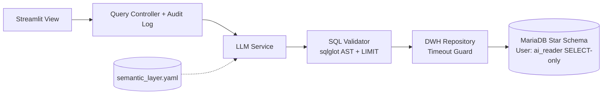

# 🛡️ DWH Text-to-SQL with Semantic Layer & AST Guardrails

Production-grade reference architecture demonstrating how to safely integrate LLMs with a Data Warehouse (**MariaDB**) using a **Semantic Layer**, **Clean Architecture**, and **Defense-in-Depth** guardrails.

## 🏗️ Architecture



## 🔒 Key Engineering & Security Practices
1. **Clean Architecture:** Strict separation of concerns (`domain`, `repositories`, `services`, `controllers`, `config`).
2. **Semantic Layer (`config/semantic_layer.yaml`):** Decouples business definitions (e.g., Net Revenue calculation, filtering `is_returned = 0`) from raw physical schemas.
3. **AST-Based SQL Validation (`sqlglot`):** Parses generated SQL into an Abstract Syntax Tree (instead of fragile Regex) to verify `SELECT`-only execution, block stacked queries, and automatically inject `LIMIT 1000`.
4. **Database RBAC & Timeouts:** Connects via a least-privilege `ai_reader` user (`SELECT` only) with session-level `max_statement_time`.
5. **CI/CD Quality Gates:** Automated linting (`ruff`) and unit testing (`pytest`) via GitHub Actions.

## 🚀 Local Setup
```bash
docker compose up -d
cp .env.example .env  # Add your GEMINI_API_KEY
python -m venv .venv
.venv\Scripts\activate
pip install -r requirements.txt
pytest
streamlit run app.py
```
